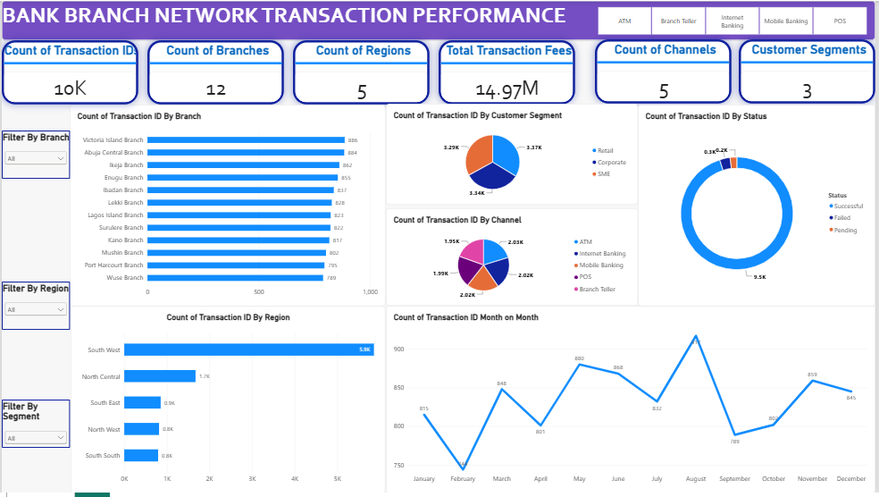

# Bank Branch Network Transaction Performance

Power BI dashboard analysing 10,000 bank transactions
across 12 branches, 5 regions and 5 channels.

## Key insights
- 95% of transactions successful
- South West = 58.6% of volume, but has 7 of 12 branches
- Monthly volume steady at about 833 transactions

## Files
- dashboard.pbix: the Power BI report
- Nigerian_Bank_Raw_Transactions_10000.csv: source data

## Tools
Power BI, DAX

## About the Data

**Synthetic dataset.** This project uses a synthetic dataset of 10,000
Nigerian bank transactions, created for practice and portfolio purposes.
It does not represent any real bank, branch or customer, and the findings
describe this dataset only.

**File:** `Nigerian_Bank_Raw_Transactions_10000.csv`
**Size:** 10,000 rows, 23 columns
**Period:** 1 January to 31 December 2025

### Coverage
| Dimension | Values |
|---|---|
| Branches | 12 |
| Regions | 5 (South West, North Central, South East, North West, South South) |
| Customer segments | 3 (Retail, Corporate, SME) |
| Channels | 5 (ATM, Branch Teller, Internet Banking, Mobile Banking, POS) |
| Transaction types | 9 (e.g. Funds Transfer, Cash Deposit, POS Purchase, Bill Payment) |
| Status | Successful, Failed, Pending |

### Key columns
| Column | Description |
|---|---|
| TransactionID | Unique ID for each transaction |
| PostingDate / PostingTime | When the transaction was posted |
| BranchName / Region | Branch handling the transaction and its region |
| CustomerSegment | Retail, Corporate or SME |
| TransactionType | Type of transaction |
| Channel | Channel used |
| DebitCredit | Debit (D) or credit (C) |
| AmountNGN | Transaction value in Nigerian naira |
| FeeNGN | Fee charged, in naira |
| Status | Successful, Failed or Pending |

### Data preparation
- `AmountNGN` and `FeeNGN` were stored as text with commas and spaces
  (for example `" 70,199.20 "`), and zero fees appeared as `"-"`.
  These were cleaned and converted to numbers.
- `PostingDate` was converted to a date type, and a month field was
  used for the monthly trend.
- No missing values or duplicate transaction IDs were found.

### Known limitations
- Every transaction type appears on every channel (for example, ATM
  withdrawals recorded through Internet Banking), so channel-level
  conclusions should be treated with caution.
- Fees apply only to Funds Transfers and Bill Payments, at a flat
  0.1% of the amount.
- Transactions are spread almost evenly across hours and weekdays,
  which is unusual for real banking data.
Findings describe this dataset only.
